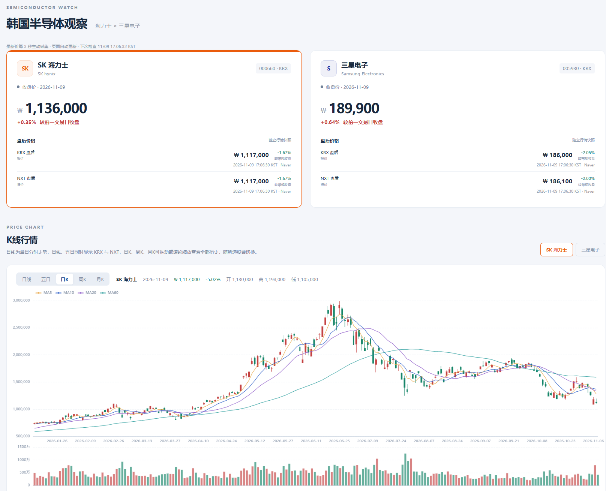
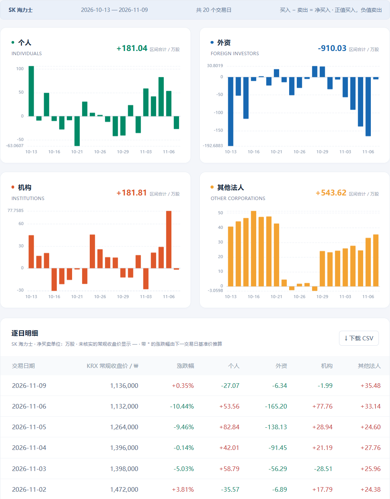
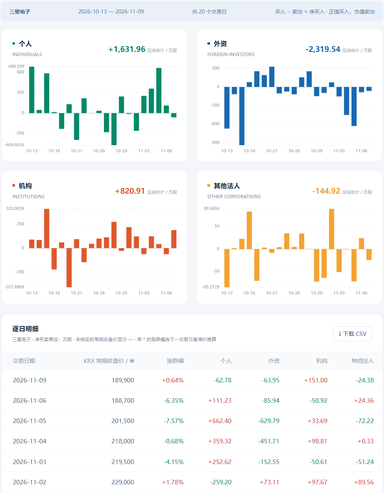
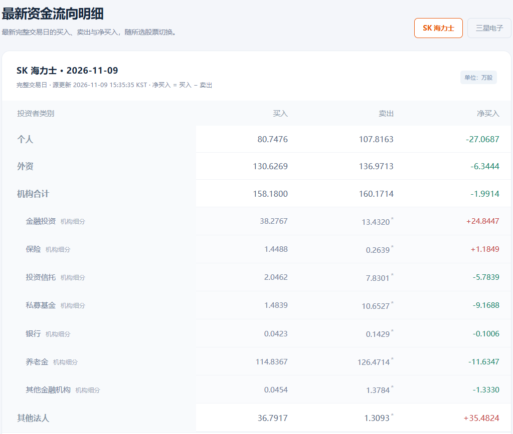
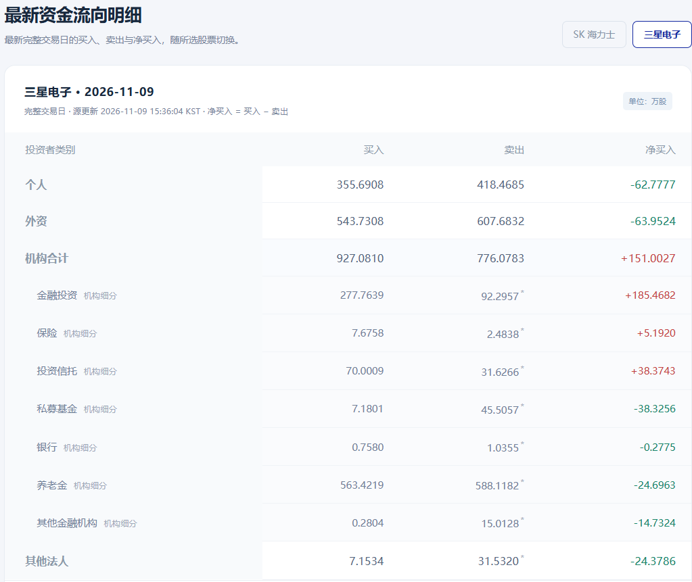
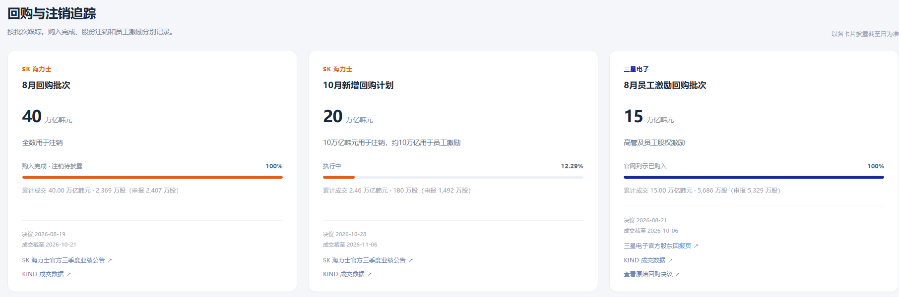

# 韩国半导体观察 · 海力士与三星股票看板

韩国半导体股票研究看板，集中查看 **SK 海力士（000660）** 和 **三星电子普通股（005930）** 的行情、投资者买卖、新闻公告及回购进度。

## 功能

| 模块         | 功能                                                                                                              |
| ------------ | ----------------------------------------------------------------------------------------------------------------- |
| 市场概览     | 查看两只股票的 KRX 常规时段最新价；常规时段外主价格显示已核实收盘价，核实前仅接受准确的 15:30 常规报价作为临时值  |
| K 线行情     | 当日分时、五日、日 K、周 K、月 K，支持成交量、MA5 / 10 / 20 / 60、缩放和历史查看；分时与五日视图另展示 NXT 采样线 |
| 最新资金流向 | 展示最新完整交易日的个人、外资、机构及其他法人买入、卖出、净买入，包含七类机构细分                                |
| 历史资金流向 | 按最近 5 / 10 / 20 个交易日查看净买卖柱状图、区间合计和逐日明细，支持 UTF-8 CSV 导出                              |
| 新闻与公告   | 展示中文译名、原标题及原文链接，新闻报道与公司披露分别呈现                                                        |
| 回购与注销   | 按批次追踪计划金额、累计成交金额及执行进度，区分购入、注销与员工激励                                              |
| 自动更新     | 后台持续采集；页面自动轮询，切回页面时刷新；失败时保留最近成功数据并提示状态                                      |
| 本地持久化   | SQLite 保存历史、来源更新时间和修订，自动生成本地备份                                                             |

最新资金流向独立于历史区间筛选。页面表格按万股显示四位小数，精确到 1 股；由“买入 − 净买入”推导的卖出量以星号标记。

## 看板页面

**股价与 K 线行情**



| SK 海力士：历史资金流向                                                              | 三星电子：历史资金流向                                                              |
| ------------------------------------------------------------------------------------ | ----------------------------------------------------------------------------------- |
|  |  |

| SK 海力士：最新买卖明细                                                                    | 三星电子：最新买卖明细                                                                    |
| ------------------------------------------------------------------------------------------ | ----------------------------------------------------------------------------------------- |
|  |  |

**回购与注销追踪**



## Windows 本地部署

### 1. 准备环境

- 安装 **Python 3.12**，并确保 PowerShell 中可以运行 `python --version`。
- 将仓库克隆或下载 ZIP 后解压到本地。
- 正常采集需要能够访问 Naver、Toss、KRX KIND 和 MyMemory 等数据源。

以下命令均在项目根目录执行；该目录包含 `README.md`、`requirements.txt` 和 `app/`。

### 2. 创建虚拟环境并安装依赖

```powershell
python -m venv .venv
.\.venv\Scripts\python.exe -m pip install -r requirements.txt
```

直接调用虚拟环境中的 Python，无需执行 `Activate.ps1` 或修改 PowerShell 执行策略。

如果使用 uv，可以改用：

```powershell
uv venv --python 3.12 .venv
uv pip sync requirements.txt --python .venv/Scripts/python.exe
```

### 3. 启动看板

```powershell
.\.venv\Scripts\python.exe -m uvicorn app.service:app --host 127.0.0.1 --port 8000 --workers 1
```

浏览器访问 **http://127.0.0.1:8000/**。保持 PowerShell 窗口开启，按 `Ctrl+C` 停止。

首次启动自动导入 `data/live/` 中两只股票各 120 个交易日的初始资金流数据，以及已有的收盘价种子。后台继续同步 K 线、行情、新闻和公告，可能需要几分钟；初始数据日期不代表当前日期。后续启动沿用本地数据库。

使用单进程 `--workers 1`，避免重复启动后台采集任务。电脑关机、休眠或退出程序期间不会采集数据。

### 4. 检查运行状态

```powershell
Invoke-RestMethod http://127.0.0.1:8000/api/health
```

- `ok`：后台任务是否正常；任务退出时接口返回 HTTP 503。
- `dataOk`：数据采集状态是否正常；数据源失败时可能仍返回 HTTP 200，需要结合该字段判断。
- `staleModules`：失败或长时间未更新的数据模块。

启动初期部分数据仍在加载，请稍后重新检查。端口被占用时，可将启动命令中的 `8000` 改为 `8001`，并同步修改浏览器地址。

### 离线预览

关闭联网采集，以仓库自带数据及本地已保存数据预览：

```powershell
$env:DISABLE_UPDATER = "1"
.\.venv\Scripts\python.exe -m uvicorn app.service:app --host 127.0.0.1 --port 8000 --workers 1
```

全新数据库的离线预览不包含尚未采集的 K 线和新闻。恢复采集前先停止程序，移除变量并重新启动：

```powershell
Remove-Item Env:DISABLE_UPDATER -ErrorAction SilentlyContinue
```

### macOS / Linux

```bash
python3.12 -m venv .venv
.venv/bin/python -m pip install -r requirements.txt
.venv/bin/python -m uvicorn app.service:app --host 127.0.0.1 --port 8000 --workers 1
```

## 本地数据与配置

默认将数据写入项目下的 `runtime/`，该目录已被 Git 忽略：

| 路径                          | 内容                                             |
| ----------------------------- | ------------------------------------------------ |
| `runtime/dashboard.sqlite3` | 行情、资金流、K 线、新闻公告、翻译缓存和采集状态 |
| `runtime/state/`            | 采集器自动生成并复用的匿名设备标识               |
| `runtime/backups/`          | 按日期生成的 SQLite 在线备份，保留最近 14 个日期 |

更换代码版本时保留 `runtime/`。需要手动复制整个运行目录时，先停止程序。备份默认仍在同一台电脑，重要数据可另行复制保存。

使用 PowerShell 环境变量可调整配置，例如：

```powershell
$env:LIVE_UPDATE_SECONDS = "7"
$env:DASHBOARD_DATA_DIR = Join-Path $PWD "runtime"
```

设置后再执行启动命令。程序不会自动加载 `.env` 文件。

| 环境变量                   | 默认值                | 说明                                            |
| -------------------------- | --------------------- | ----------------------------------------------- |
| `DASHBOARD_DATA_DIR`     | 项目下的 `runtime/` | 本地持久化目录                                  |
| `DISABLE_UPDATER`        | 未设置                | 设置为 `1` 时关闭后台采集                     |
| `LIVE_UPDATE_SECONDS`    | `3`                 | 活跃窗口内最新报价采集间隔，秒                  |
| `LIVE_OFF_HOURS_SECONDS` | `300`               | 其他时段最新报价采集间隔，秒                    |
| `PRICE_UPDATE_SECONDS`   | `60`                | 常规收盘与盘后价格检查间隔，秒                  |
| `KLINE_UPDATE_SECONDS`   | `60`                | 活跃窗口内 K 线刷新间隔，秒；其他时段为 1800 秒 |
| `UPDATE_SECONDS`         | `1800`              | 资金流、新闻与公告常规检查间隔，秒              |
| `KIND_UPDATE_SECONDS`    | `21600`             | 回购执行进度检查间隔，秒                        |

报价活跃窗口为工作日韩国时间 07:50–20:10；资金流另在工作日北京时间 14:30–14:45 每分钟检查。页面每秒读取轻量行情接口，每 30 秒刷新 K 线，每 60 秒刷新完整数据。

## 数据来源与口径

- **行情与 K 线**：Naver 公开网页接口。实时价、已核实的 KRX 常规收盘价、KRX / NXT 盘后报价分别保存；K 线收盘值不直接写入常规收盘表。
- **投资者买卖、新闻和公告索引**：Toss 公开网页接口。匿名设备标识由程序自动生成并保存在本地，不需要账号、密码或 API 密钥。
- **回购执行进度**：韩国交易所 KIND 页面。计划批次由 `data/repurchases.json` 人工维护，执行进度按累计成交金额与计划金额计算，新批次需要手动加入。
- **标题翻译**：MyMemory，仅发送公开标题；程序设置每日 4500 字符调用预算并缓存去重。翻译不可用时保留原标题；可通过 `data/title-overrides.json` 校订。
- **单位**：价格为韩元（KRW），图表买卖量为万股，CSV 买卖量为股。买卖股数不等于韩元资金净额。
- **缺失数据**：未知值保留为空，不补零，不用盘后价补历史常规收盘价。部分推导值在页面标记。
- **历史与时段限制**：资金流可补抓停机期间的历史；常规收盘来源仅覆盖有限日期，缺失较久可能无法补回。交易所假日和特殊收盘时间没有完整建模。
- **NXT 采样线**：本地按报价累积的分钟采样，保留 30 天，无成交量、历史回补或成交完整性保证。

公开网页接口可能限流或变更，程序失败时保留最近成功数据。默认 3 秒报价采集快于来源建议的 7 秒间隔，可通过 `LIVE_UPDATE_SECONDS=7` 调整；连续失败时会退避重试。

本项目用于信息整理和研究，不构成投资建议。公开可访问不代表取得行情商业再分发许可。详细说明见 [价格与时段口径](docs/price-sessions.md)、[Toss 采集说明](docs/toss-400-investigation.md)。

## 项目结构

```text
app/
  service.py           # FastAPI 接口、SQLite、后台任务、翻译与备份
  prices.py            # 报价解析、常规收盘与盘后时段校验
  klines.py            # K 线清洗、周月汇总、NXT 采样
  kind.py              # KIND 回购数据解析
web/                   # 页面、样式、交互和本地图表库
scripts/               # 独立资金流采集及可选诊断脚本
data/                  # 初始公开数据、回购批次和标题校订
image/                 # README 看板截图
docs/                  # 数据口径与采集说明
tests/                 # Python 与 JavaScript 测试
requirements.txt       # 锁定的 Python 依赖
```

## 独立采集资金流

采集脚本仅依赖 Python 标准库，可单独执行：

```powershell
.\.venv\Scripts\python.exe scripts/fetch_toss.py --product-code A000660 --days 120 --state-dir .state --output runtime/A000660.json
.\.venv\Scripts\python.exe scripts/fetch_toss.py --product-code A005930 --days 120 --state-dir .state --output runtime/A005930.json
```

输出包含完整交易日记录 `rows`、原始分页 `pages`、抓取时间和校验结果 `checks`；自动剔除未完成交易日，并核对买入减卖出等于净买入、最新机构细分与合计一致。独立脚本输出不会自动导入正在运行的看板数据库。

## 开发验证

Python 测试需额外安装 `httpx`：

```powershell
.\.venv\Scripts\python.exe -m pip install httpx
.\.venv\Scripts\python.exe -m unittest discover -s tests -v
```

JavaScript 测试需要支持 `node --test` 的 Node.js，仅开发验证需要：

```powershell
node --check web/assets/app.js
node --test tests/test_flow_detail.cjs tests/test_app_refresh.cjs tests/test_kline.cjs
```
